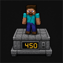

# Weight Challenge

Multi-loader Minecraft mod (Fabric + NeoForge) inspired by the “I’m obese and I need to lose weight” challenge: every player has a **body weight in kg**, loses or gains it from actions, sees it on a **HUD**, and **scale** changes via the vanilla `generic.scale` attribute.

French UI strings are included (`fr_fr`); **English is the default**.



## Supported versions

| Minecraft | Fabric API (example) | NeoForge (example) | Java |
|-----------|----------------------|--------------------|------|
| **1.21.11** | `0.139.5+1.21.11` | `21.11.3-beta` | 21 |
| **26.1.2** | `0.155.3+26.1.2` | `26.1.2.27-beta` | 25 |
| **26.2** | `0.161.0+26.2` | `26.2.0.93` | 25 |
| **26.3** | `0.165.0+26.3` | `26.3.0.99` | 25 |

Versions live in `versions/<version>.properties`. Default active version is **1.21.11** (`gradle.properties` → `mcVersion`).

## Mechanics

### Weight

- **Start**: 450 kg (configurable)
- **Displayed goal**: 90 kg (configurable, informational)
- **HUD**: action bar (or a more visible “overlay” style), updated in real time
- **Multiplayer**: weight is stored on the server (player attachment), synced to the client for the HUD; scale uses `Attributes.SCALE` on the server

### Weight loss (defaults)

| Action | Effect |
|--------|--------|
| Walking / moving | −0.1 kg / s |
| Sprinting (when allowed) | −0.1 kg / s |
| Swimming | −0.15 kg / s |
| Mining | −0.08 kg / s |
| Sneaking (each activation) | −0.2 kg |
| Jumping | −0.5 kg |
| Hitting an entity | −0.05 to −0.6 kg (random, configurable bounds) |

### Weight gain

| Action | Effect |
|--------|--------|
| Standing still | +0.1 kg / s |
| Eating | per food (JSON table, e.g. melon +0.3 kg, steak ~+6 kg, default +0.5 kg) |

### Weight-related effects

- Above the **sprint threshold** (default 180 kg): the player **cannot sprint**
- **Size**: interpolates between `scaleAtMinWeight` and `scaleAtMaxWeight` from weight (default references 90–450 kg)
- **Falls** (optional): above 200 kg, fall damage is multiplied (×1.5 by default)

## Commands (OP / GameMaster)

```
/weight set <player> <kg>
/weight add <player> <delta>
/weight reset <player>
/weight get [player]
```

## Configuration

On first launch the mod creates:

`config/weightchallenge.json`

A full example is in the repo: [`config/weightchallenge.example.json`](config/weightchallenge.example.json).

All rates, thresholds, scale bounds, and food gains are editable there.

## Install (players)

1. Install **Fabric** or **NeoForge** for your Minecraft version.
2. Install **Fabric API** (Fabric only).
3. Drop the matching JAR into `mods`:
   - `weightchallenge-fabric-<modVersion>-<minecraftVersion>.jar`
   - `weightchallenge-neoforge-<modVersion>-<minecraftVersion>.jar`

Exact names depend on the Minecraft version you built (see `build/libs/`).

## Build

Requirements: **JDK 21** for 1.21.11, **JDK 25** for the 26.x line.

```bash
# Minecraft 1.21.11 (default)
./gradlew build

# Other versions
./gradlew build -PmcVersion=26.1.2
./gradlew build -PmcVersion=26.2
./gradlew build -PmcVersion=26.3
```

Output JARs:

- `fabric/build/libs/weightchallenge-fabric-<modVersion>-<minecraftVersion>.jar`
- `neoforge/build/libs/weightchallenge-neoforge-<modVersion>-<minecraftVersion>.jar`

### Dev client

```bash
./gradlew :fabric:runClient
./gradlew :neoforge:runClient
```

## Project layout

| Module | Role |
|--------|------|
| `common` | Shared logic, config, commands, mixins, networking |
| `fabric` | Fabric entry, attachments, events, client HUD |
| `neoforge` | NeoForge entry, attachments, events, client HUD |

Based on the [MultiLoader Template](https://github.com/jaredlll08/MultiLoader-Template) (1.21.11).

## License

MIT — see [LICENSE](LICENSE).
